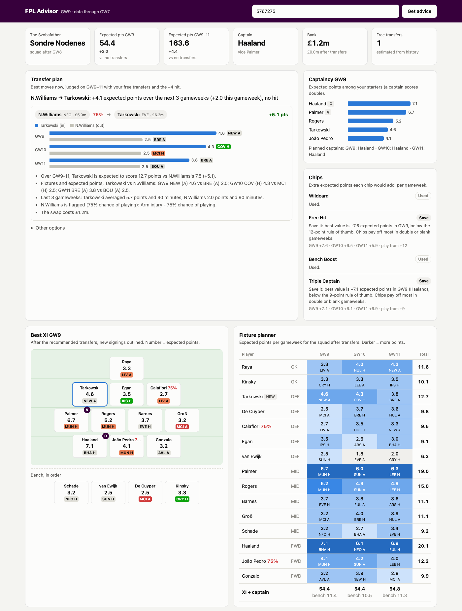
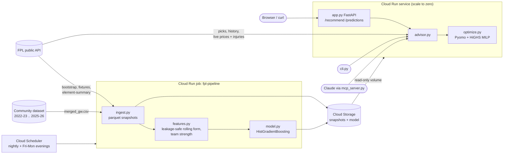

# fpl-advisor

[](https://github.com/sondreNodenes/fpl-advisor/actions/workflows/ci.yml)

A Fantasy Premier League advisor. Paste an FPL team URL or ID
(e.g. `https://fantasy.premierleague.com/en/entry/5767275/event/8`) and get:

1. **Predicted points for every player** for the next gameweek, from a gradient-boosted model
   trained on four past seasons plus the current one.
2. **Recommended transfers** (0, 1 or 2, net of the 4-point hit) **planned over the next 3
   gameweeks**, with the reasons behind each swap (expected points per week, fixtures, recent form,
   injury flags, price), plus **captain, vice-captain and the best starting XI**, from a
   mixed-integer program over the full FPL rules (budget, 2/5/5/3 squad, max 3 per club, valid
   formation, captain scores double).
3. **Chip timing**: the expected extra points from Wildcard, Free Hit, Bench Boost and Triple
   Captain for each week in the horizon, and whether to play or save each one.

You can use it from a web page, a CLI, a JSON API, or Claude via an MCP server. Data refreshes
automatically after matches.

**Live:** https://fpl-advisor-7dembcoibq-lz.a.run.app (Cloud Run, `europe-north1`; the first
request after idle takes a few seconds while an instance starts).



## Architecture



| Module | Role |
|---|---|
| `api.py` | Polite FPL client (1 s between calls, retries, file cache), URL parsing, typed parsers, free-transfer estimate |
| `ingest.py` | Snapshots each finished gameweek to `data/snapshots/gw=NN/*.parquet` (idempotent); downloads past seasons |
| `features.py` | Per-fixture rows; rolling 1/3/5-GW and season-to-date form, own and opponent goals/xG for and against |
| `model.py` | Trains and saves the model; predicts a gameweek (sums double gameweeks, 0 for blanks, × chance of playing) |
| `evaluate.py` | Season-by-season, time-ordered evaluation against baselines → `RESULTS.md` |
| `optimize.py` | MILP for transfers now plus an XI and captain for each of the next 3 gameweeks; one solve per transfer count, ranked by net expected points |
| `security.py` | Rate limits, body size limit, concurrency limit, security headers and CSP, JSON logs |
| `chips.py` | Chip windows and usage from the API; expected value of each chip per gameweek; play/save verdict |
| `advisor.py` | Service layer shared by the web app, CLI and MCP server |
| `app.py`, `static/index.html` | FastAPI and a single dependency-free HTML page |
| `pipeline.py` | Job entrypoint: ingest, then retrain only if a new gameweek landed |
| `infra/` | Terraform: `bootstrap` (IAM, WIF, registry, bucket) and `app` (Cloud Run, Scheduler) |

## Run locally

Requires Python 3.12 and [uv](https://docs.astral.sh/uv/).

```bash
uv sync
make ingest       # snapshot the last finished gameweek + download past seasons (~10 min first time)
make train        # fit and save models/model.joblib
make evaluate     # regenerate RESULTS.md
make run          # http://127.0.0.1:8000
uv run python -m fpl_advisor.cli "https://fantasy.premierleague.com/en/entry/5767275/event/8"
make test lint
```

API:

```bash
curl -X POST localhost:8000/recommend -H 'content-type: application/json' -d '{"team": "5767275"}'
curl "localhost:8000/predictions?position=MID&limit=10"
curl localhost:8000/health
```

## Use from Claude (MCP server)

`fpl_advisor/mcp_server.py` exposes four tools over stdio: `get_team(team)`,
`predict_player(name)`, `recommend_transfers(team)` and `captain_options(team)`.
It needs local data and a model first (`python -m fpl_advisor.ingest && python -m fpl_advisor.model`).

Claude Code:

```bash
claude mcp add fpl-advisor -- uv run --directory /path/to/fpl-advisor python -m fpl_advisor.mcp_server
```

Claude Desktop (`claude_desktop_config.json`):

```json
{
  "mcpServers": {
    "fpl-advisor": {
      "command": "uv",
      "args": ["run", "--directory", "/path/to/fpl-advisor", "python", "-m", "fpl_advisor.mcp_server"]
    }
  }
}
```

Then ask, for example, "Who should team 5767275 captain this week?".

## Deploy (GCP)

All infrastructure is Terraform in `infra/`, split in two roots:

- `infra/bootstrap` (applied once by you): APIs, Artifact Registry, data bucket, service
  accounts with least privilege, and Workload Identity Federation for GitHub Actions
  (only `main` of this repo can deploy; no JSON keys).
- `infra/app` (applied by `.github/workflows/deploy.yml` on every push to `main`): Cloud Run
  service (public, scale to zero), Cloud Run job `fpl-pipeline` (ingest + retrain), and two
  Cloud Scheduler triggers (nightly 03:00 UTC, and 19:00/22:00 UTC Friday to Monday).

The data bucket is mounted into Cloud Run as a volume (read-only for the service,
read-write for the job), so the code only ever reads and writes local paths.

Steps (also in `BLOCKERS.md`):

```bash
gcloud auth login && gcloud auth application-default login
gcloud config set project <project-id>
gcloud services enable cloudresourcemanager.googleapis.com serviceusage.googleapis.com
make bootstrap                      # state bucket <project-id>-tfstate + infra/bootstrap
gh variable set GCP_PROJECT_ID --body <project-id>
gh variable set GCP_WIF_PROVIDER --body "$(terraform -chdir=infra/bootstrap output -raw workload_identity_provider)"
gh variable set GCP_DEPLOY_SA --body "$(terraform -chdir=infra/bootstrap output -raw deployer_service_account)"
gh workflow run deploy.yml          # build, push, terraform plan + apply, smoke test /health
make run-job                        # first data load (~10 min)
```

### Cost

Designed to stay at or near 0 USD/month. Nothing bills while idle: no load balancer, NAT,
GKE or minimum instances.

| Resource | Usage | Expected cost |
|---|---|---|
| Cloud Run service | scale to zero, low traffic | free tier |
| Cloud Run job | ~80 runs/month, most under a minute; ~5 runs of ~10 min after a gameweek | free tier |
| Cloud Scheduler | 2 jobs (3 free per billing account) | free |
| Cloud Storage | ~10 MB parquet + model | < 0.01 USD |
| Artifact Registry | 3 images kept (cleanup policy) | ~0.10 USD if above the 0.5 GB free tier |

These are estimates from Google's published free tiers, not measured bills. Set a 5 USD budget alert.
`make destroy` removes everything Terraform created (the state bucket is kept).

A budget alert does not cap spending. If someone floods the public service from many IPs, the
measured worst case is about **$930/month** (one instance saturated all month, mostly
per-request fees; see [Security](#security)).

## Security

A security pass threat-modelled the system, added scanners to CI and hardened the app, the
container, the pipeline and the cloud setup, with before/after evidence:

- [THREAT_MODEL.md](THREAT_MODEL.md): assets, trust boundaries and STRIDE threats.
- [SECURITY_FINDINGS.md](SECURITY_FINDINGS.md): every finding with its source, the fix or the
  reason it is accepted, and per-tool counts before and after.
- `make security` runs Gitleaks, pip-audit, ruff's bandit rules, Trivy (image and IaC) and the
  abuse tests in `tests/test_security.py` with pinned tool versions; `.github/workflows/security.yml`
  runs the same on every push, pull request and weekly.

What the app does on the internet-facing side: only an integer team ID or the exact
`fantasy.premierleague.com/entry/{id}` URL is accepted and the input is never fetched; 120
requests/min per IP on every route and 10/min on `/recommend` (429); 4 KiB request bodies (413);
at most 2 optimizations at once per instance (503 when busy) with a 60 s limit (504); a strict
Content-Security-Policy with no inline script or style; generic error messages with details only
in structured logs.

**Kill switch** if the bill alert fires: stop public traffic immediately with
`gcloud run services update fpl-advisor --region europe-north1 --ingress internal`, or remove
everything with `make destroy`.

Not done (out of scope or future work): Cloud Armor or another WAF, authentication, an SBOM,
signed images (cosign) and admission checks, a budget-triggered automatic shutdown.

## Results

From `RESULTS.md`, produced by `python -m fpl_advisor.evaluate` (re-run it to reproduce).
Each test season is predicted by a model trained only on earlier seasons. Scores are per
player per gameweek, for **active players** (played in at least one of their last 3 gameweeks).

| Test season (rows) | Metric | Last-3-GW average | Form-only model | Full model |
|---|---|---|---|---|
| 2025-26 (13,533) | MAE ↓ | 2.157 | **1.854** | 1.867 |
| 2025-26 (13,533) | Spearman ↑ | 0.375 | 0.483 | **0.485** |
| 2026-27 GW2-7 (2,197) | MAE ↓ | 2.172 | **1.863** | 1.866 |
| 2026-27 GW2-7 (2,197) | Spearman ↑ | 0.399 | 0.498 | **0.519** |

What this says, plainly:

- Both models clearly beat the last-3-gameweek baseline: 13-14% lower MAE and +0.10 to
  +0.12 rank correlation.
- Opponent and home/away context adds little over form alone. The full model ranks slightly
  better but its MAE is slightly worse. Across all players in 2025-26 it ranks *worse* than
  form-only (0.725 vs 0.750); see `RESULTS.md`.
- **No comparison with FPL's own `ep_next` yet.** The API does not keep past `ep_next`
  values, and the community dataset's `xP` column ranks 90-minute starters at Spearman 0.586,
  which only post-deadline information can explain, so it is not a fair baseline. The pipeline
  now snapshots `ep_next` before every deadline, and `evaluate` adds the column automatically
  once GW9 finishes.

## Limitations

- **Unofficial API.** FPL can change or rate-limit endpoints without notice. The client is
  polite (1 request/s, cached), but a long outage stops ingestion.
- **Small current-season window.** In-season data is 7 gameweeks. Past seasons help, but
  player IDs differ per season, so form resets each August.
- **No injury history in training.** `chance_of_playing_next_round` exists only at snapshot
  time, so it is applied as a multiplier after the model rather than learned.
- **Selling prices are approximated** with current prices (the public picks endpoint does not
  include them), so the budget can be slightly optimistic after price rises.
- **Free transfers are estimated** from transfer history using the current rules (1 per week,
  roll over to 5, wildcard/free hit keep the count). Special mid-season top-ups are not modelled.
- **Transfers are planned now, not later.** The optimizer picks this week's transfers for the
  best 3-gameweek total (later weeks weighted 0.9 and 0.81), but does not plan future transfers.
- **Chip thresholds are rules of thumb** (Wildcard 15, Free Hit 12, Bench Boost 12, Triple
  Captain 9 expected extra points), not fitted values. Chip values use the same predictions as
  everything else, and the horizon only sees 3 gameweeks.

## What I would do next

- Score the model against FPL's `ep_next` as the snapshots accumulate, and report it.
- Plan future transfers too (rolling free transfers across the horizon), and a longer
  horizon for chip timing around known blank and double gameweeks.
- Use fixture difficulty and bookmaker-implied goal expectations as opponent features, since
  rolling goals and xG proved weak.
- Model minutes separately (P(start), P(60+)) and multiply by points per 90; most error is
  rotation and benching, not scoring.
- Read real selling prices for authenticated users.
